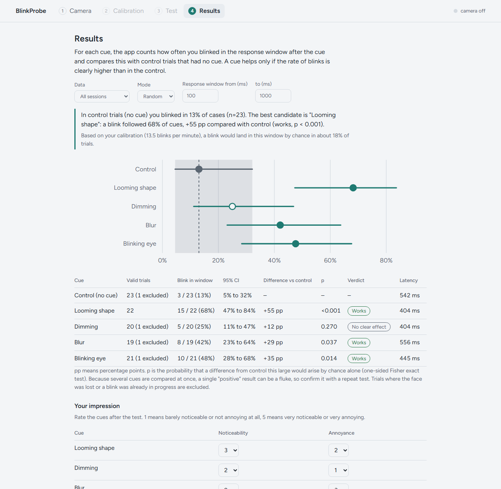

# BlinkProbe

BlinkProbe is a single-file web app that uses your webcam to count blinks and tests which subtle on-screen cue most reliably triggers a reflex blink while you read on a screen.

[](LICENSE) [](https://admirbajric.github.io/blinkprobe/) 

<picture>
  <source media="(prefers-color-scheme: dark)" srcset="docs/results-dark.png">
  
</picture>

*Results view with sample data. Each cue's blink rate and 95% confidence interval is compared with the control trials that had no cue.*

## Why

During concentrated screen work, people blink roughly half as often as usual. Relaxed, most people blink about 15 to 20 times a minute; focused on a screen, that often drops to 8 to 10. Many of the blinks that remain are incomplete, so the tear film is not renewed properly. It then evaporates, and the eyes can start to burn, itch or blur late in the day.

Spontaneous blinking tends to fade during deep concentration, but reflex blinks remain: something approaching the face or a sudden change of light still makes you blink without deciding to. A future blink reminder could use this by showing a subtle cue in your peripheral vision that triggers a reflex blink without pulling your attention away from the work.

BlinkProbe is the experiment tool for finding out which cue actually works for a given person. People cannot reliably tell by feel what helps, because blinks that would have happened anyway are easily credited to the cue. BlinkProbe therefore mixes in control trials with no cue, counts the blinks that follow each cue within a fixed response window, and compares every cue with the controls using confidence intervals and an exact test.

## Try it

Live demo: [admirbajric.github.io/blinkprobe](https://admirbajric.github.io/blinkprobe/)

To run it locally, clone or download the repository and open `index.html` in a desktop browser. You can also serve the folder:

```sh
git clone https://github.com/AdmirBajric/blinkprobe.git
cd blinkprobe
python3 -m http.server 8000   # then open http://localhost:8000
# or
npx serve                     # then open the localhost address it prints
```

Requirements:

- A desktop browser: Chrome, Edge or Firefox.
- A webcam. The browser asks for permission when you enable it.
- An internet connection on the first load. The MediaPipe library, the face model (a few MB, cached by the browser) and two fonts are fetched at runtime. There is nothing to install and no build step.
- A secure context, because browsers only allow camera access there: an `https://` page such as the live demo, `http://localhost`, or the file opened from disk (`file://`) in a desktop browser. A plain `http://` address on another machine will not work.

## How a session works

A session has four steps: Camera, Calibration, Test and Results. With the default settings, calibration and test take about 22 minutes.

### 1. Camera

- Enable the camera and, if several are connected, choose one. The same button switches the camera off again. A small mirrored preview confirms that the right camera is active; it is hidden again during calibration and test.
- A status indicator in the header shows the tracking state at all times: camera off, face tracked, face not visible, or no camera image.
- A live graph plots the eye-closure score of the last 8 seconds (0 is open, 1 is closed), with the detection threshold and a marker for every detected blink.
- Quality chips show: face found, frames per second (24 or more is good, 15 or more a warning), light (mean brightness below 70 is low, above 210 too bright, on a 0 to 255 scale), distance (face width as a fraction of the frame; below 0.18 is too far, above 0.7 too close) and a live blink count.
- A short checklist comes before you continue: blink a few times and watch the graph and the counter, check light and distance, and confirm that the face stays tracked when your eyes are lowered to the text.

### 2. Calibration

- Read the built-in text (a short article on why we blink less in front of a screen) or paste your own. Choose 30 seconds (quick check only), 1, 2 (default) or 3 minutes. No cues appear.
- The result shows blinks per minute, the share of incomplete blinks (an estimate), the typical (median) gap between blinks, the longest gap and the total number of blinks counted.
- A note appears if the face was lost for more than 25% of the time, or if the rate is below 2 or above 40 blinks per minute. The app then suggests improving light and position, or checking in the Camera step that the graph really follows your blinks.
- Calibration can be skipped. Without one, the results page cannot show the chance-rate estimate or the calibration figures.

### 3. Test

- Read the built-in text (or your own) while cues appear on their own. There is nothing to press, and control trials with no cue are mixed in.
- Choose which cues to include (each can be previewed) and the intensity, from 0 to 100% (default 40%).
- Set the spacing between cues: shortest interval 3 to 60 s (default 8) and longest interval 3 to 90 s (default 16). The first cue comes 5 to 8 s after the start. Later intervals are drawn at random between your two values, plus 1.8 s while the previous trial is recorded.
- Choose a mode. **Random**: cues arrive independently of your blinking, which gives the cleanest measurement. **Adaptive**: a cue (or a control) comes only after you have not blinked for 4 to 20 s (default 8), which is how a finished reminder would behave.
- Choose a duration: 2 (quick check only), 10, 20 (default), 30 or 45 minutes, or until stopped. The form estimates how many trials that gives, in total and per cue.
- Cues are dealt from a shuffled deck holding each enabled cue once plus ceil(n/2) control trials, where n is the number of enabled cues. Controls are therefore interleaved with the cues, and a new shuffled deck is dealt when the old one runs out.
- A cue fires only when the tab is visible, the camera image is fresh, the face is tracked and no blink is in progress. A banner appears when cues are paused because the tab is in the background, the face is out of frame or the camera stops delivering images.
- A bar at the top of the page shows elapsed time and the trial count. Esc or the Stop button ends the run, and a trial still in progress is discarded. A screen wake lock is requested during the test where the browser supports it.

### 4. Results

- A plain-language summary names the most promising cue, if there is one, and suggests trying a lower intensity if you rated that cue 4 or 5 for Annoyance.
- A table starts with the control row, followed by one row per cue: valid trials, hit rate (shown as Blink in window) with its 95% confidence interval (CI), difference vs control in percentage points (pp), p-value, verdict and median latency. A forest-style plot shows the same rates. The next sections explain each figure.
- Filters: all sessions or the last session only, the mode (Random and Adaptive results are never pooled) and the response window.
- Subjective ratings per cue: Noticeability and Annoyance, each from 1 to 5.
- Blink statistics compare your blink rate and share of incomplete blinks in calibration and in the test. The test figure includes blinks triggered by the cues.
- Export the data as JSON or CSV, or delete everything.

## The cues

| Cue | What you see | Notes |
| --- | --- | --- |
| Looming shape | A small shape beside the text grows quickly, as if it were approaching. | Soft-edged and placed in the periphery, left or right of the text at a random height. Lasts about half a second. |
| Dimming | The whole screen dims slightly for a moment. | A translucent black layer over the page, so it covers the browser viewport rather than other applications. Lasts about half a second. |
| Blur | The text blurs slightly for a moment. | Only the reading text is blurred. Lasts about half a second. |
| Blinking eye | A tiny eye icon beside the text blinks twice. | Placed in the periphery like the Looming shape. Lasts about one second. |

Every cue is a single brief pulse and never flickers. Intensity scales how strong a cue is: size and opacity for the shape and the eye, depth for the dimming, strength for the blur. Each cue can be previewed and switched off before a test.

## How results are evaluated

For every cue, BlinkProbe counts how often a blink starts shortly after it and compares that rate with the rate for control trials.

- **Response window.** A trial is a hit if a blink starts inside the response window, by default 100 to 1000 ms after the cue. You can change the window in the Results step (start 0 to 800 ms, end 300 to 1500 ms) and every figure updates.
- **Valid trials.** A trial is excluded, not counted as a miss, if face tracking was lost from 300 ms before to 1500 ms after the cue (gaps of more than 200 ms between camera frames count as lost), or if a blink was under way around the time of the cue or started before the response window opened. The table shows how many trials were excluded per cue.
- **Control trials** are scored the same way, with the window measured from the moment a cue would have appeared. Their hit rate is the baseline the cues are compared with.
- **Hit rate** is hits divided by valid trials, shown with a Wilson 95% CI.
- **Difference** is the cue's hit rate minus the control's, in percentage points (pp).
- **p-value** comes from a one-sided Fisher exact test of the cue's hits and misses against those of the control trials. It is the probability of a difference at least this large arising by chance alone. It is not adjusted for the number of cues compared.
- **Latency** is the median time from the cue to the first blink onset inside the window, over the hit trials.

The verdict comes from the first rule that matches:

| Order | Verdict | Condition |
| --- | --- | --- |
| 1 | Too little data | Fewer than 8 valid trials for the cue or for the control |
| 2 | No clear effect | The difference is zero or negative |
| 3 | Works | p < 0.05 and the difference is at least 10 pp |
| 4 | Possible effect | p < 0.15 |
| 5 | No clear effect | None of the above |

The forest-style plot (SVG) shows each cue's hit rate and 95% CI next to the control's rate, with the control's interval drawn as a shaded band. From your calibration rate the app also estimates how often a blink would land in the window by chance alone, assuming blinks occur at random at that rate: `1 - exp(-blinks per minute / 60 × window length in seconds)`. At 15 blinks per minute and the default 0.9 s window that is about 20%.

Because several cues are compared at once, a single positive result can be a fluke. Confirm it with a repeat test. As a rule of thumb, about 15 to 20 valid trials per cue are needed for a reliable conclusion. The app shows this hint until a cue has at least 8 valid trials.

## Privacy

- All processing happens in your browser. Camera frames are processed on your computer by MediaPipe and are never recorded or uploaded. There is no backend and there are no analytics.
- Results are stored in your browser's `localStorage` under the key `blinkprobe.v1`. The key `treptaj.v2` from the original prototype is read as a fallback. The data consists of blink timings relative to the cues, your settings, calibrations and ratings, never images or video. If storage is unavailable, the app warns you and results survive only while the page stays open, so export them before closing it.
- On the Results step you can export everything as JSON or CSV (see below) and delete all data, which removes every stored trial, calibration, session and rating after a confirmation.
- The only network requests are:
  - The page itself, from GitHub Pages (live demo) or from wherever you serve it.
  - `cdn.jsdelivr.net`: the `@mediapipe/tasks-vision` library (`vision_bundle.mjs` and the WebAssembly runtime in `wasm/`). Versions 0.10.21, 0.10.14 and the latest release are tried in that order until one loads.
  - `storage.googleapis.com`: the model `mediapipe-models/face_landmarker/face_landmarker/float16/1/face_landmarker.task`, a few MB, cached by the browser.
  - Google Fonts (`fonts.googleapis.com` and `fonts.gstatic.com`): the Figtree and Newsreader typefaces.

As with any third-party resource, these hosts can see standard request metadata such as your IP address. No other requests are made.

## Data export

The JSON file (`blinkprobe-data.json`) contains everything the app has stored:

- trials: one entry per completed trial with the cue (or control), session, mode, intensity, timestamp, whether the trial is valid, and every blink recorded from 500 ms before to 1500 ms after the cue (onset, end, peak closure and a complete flag, in milliseconds relative to the cue);
- calibrations: blinks per minute, share of incomplete blinks, median and longest gap, share of time the face was lost, and the baseline score;
- sessions: mode, enabled cues, intensity, duration, blink rate, share of incomplete blinks and trial count for each test;
- ratings: your Noticeability and Annoyance scores per cue.

The CSV file (`blinkprobe-trials.csv`) has one row per trial, with comma-separated fields and these columns:

| Column | Meaning |
| --- | --- |
| `session` | Session id. |
| `mode` | `random` or `adaptive`. |
| `cue` | `loom`, `dim`, `blur`, `eye`, or `sham` for a control trial. |
| `intensity` | Cue intensity as a fraction from 0 to 1. |
| `time` | Time of the trial as an ISO 8601 UTC timestamp. |
| `valid` | 1 if the trial is valid, 0 if it is excluded. |
| `hit` | 1 if a blink started inside the response window, 0 if not; empty for invalid trials. |
| `latency_ms` | Onset of the first blink inside the window, in ms after the cue; empty if there was none. |
| `blink_onsets_ms` | Onsets of all blinks recorded around the trial, in ms relative to the cue. |

Blink onsets in `blink_onsets_ms` are joined with `|`, for example `340|780`. The columns `valid`, `hit` and `latency_ms` use the response window set on the Results step at the time of export. All stored trials are exported, regardless of the other filters.

## Tips for a good measurement

- Put the light in front of you, not behind you. Light from behind (a window or lamp behind your head) darkens your face for the camera.
- Reflections on glasses reduce accuracy.
- Sit at your usual distance from the screen, with the camera as close to the top edge of the screen as possible.
- Before you start, check that the graph follows your blinks and that the counter rises when you blink.
- Check that the face stays tracked when you look down at text, not only when you look straight at the camera.
- Keep the tab in the foreground. Cues are paused while it is hidden.
- Read as you normally would. Do not look for the cues and do not try to control your blinking.
- Test fewer cues at once if you want more trials per cue. The form shows the estimated number of trials before you start.

## Limitations and disclaimer

- The blink data is an estimate from a webcam. Accuracy depends on lighting, camera quality and frame rate, head position and glasses, and very short or partial blinks can be missed.
- The incomplete-blink share is a rough estimate. A blink counts as complete when the closure score reaches at least halfway between your baseline and fully closed.
- This is a self-experiment with n = 1: the results describe you, in your own setup. A positive verdict is not proof, and it does not carry over to other people.
- BlinkProbe is not a medical device. It does not diagnose, treat or screen for any condition. If your eyes regularly burn, itch, feel dry or blur late in the day, see an eye doctor.

## Technical notes

- **Single file.** Markup, CSS and vanilla JavaScript live in `index.html`, with the script as one inline ES module. There is no framework, no bundler and nothing to install. MediaPipe is the only external code and is loaded at runtime.
- **Eye-closure score.** MediaPipe Face Landmarker (GPU delegate with CPU fallback) tracks one face and outputs blendshape scores. The `eyeBlinkLeft` and `eyeBlinkRight` scores are averaged into an eye-closure score from 0 (open) to 1 (closed). Frames are handled with `requestVideoFrameCallback` and the camera's capture timestamps where the browser provides them.
- **Blink detector.** `BlinkDetector` keeps an adaptive baseline of the resting score. The baseline adapts slowly when the score creeps up (time constant 8 s), so gradual shifts such as lowering your gaze are absorbed instead of counted as blinks, and faster when it drops (1.5 s). A blink starts when the score rises at least 0.22 above the baseline and ends when it falls back below the baseline plus 0.10. It is accepted if it stays raised for at least 2 frames, or reaches 0.45 above the baseline in a single frame, and lasts at most 1000 ms. Longer closures are dropped and the baseline resets. Each event records onset, end, duration, peak and a complete or incomplete flag.
- **Trials.** A `Recorder` keeps the blinks and the stretches of lost tracking, and closes each trial 1.7 s after its cue. The cue time is taken at the next animation frame plus 16 ms, to approximate when the cue is actually on screen. Control trials ("sham" in the code) come from the same shuffled deck as the cues.
- **Rendering.** Cues are plain DOM elements animated with the Web Animations API (a fixed overlay, plus a blur filter on the reading text), the live graph is drawn on a canvas and the results plot is hand-written SVG. The interface is in English and follows the system light or dark theme.
- **Testable core.** The detector, recorder, statistics (Wilson interval, Fisher test, summaries, verdicts) and scheduling (deck, delays) are DOM-free and are exposed through a `module.exports` hook for Node tests.
- **Diagnostics.** `window.__blinkprobe` exposes the app state, the stored data and the recorder for inspection from the browser console.

## Roadmap

Planned, not yet implemented:

- A Bosnian locale (the original language of the interface)
- Automated tests for the core, with CI
- Offline support (PWA)
- Additional cue types

## Contributing

Issues and pull requests are welcome. When reporting a problem, please include your browser, operating system and camera, and what the live graph showed.

- Keep the project dependency-free and single-file: no build step, no bundler, no framework.
- Use English for code, comments and documentation.

## License

BlinkProbe is released under the [MIT License](LICENSE). Maintained by [AdmirBajric](https://github.com/AdmirBajric).

## Acknowledgements

- [MediaPipe Face Landmarker](https://ai.google.dev/edge/mediapipe/solutions/vision/face_landmarker) provides the face tracking and blendshape scores.
- [Figtree](https://fonts.google.com/specimen/Figtree) and [Newsreader](https://fonts.google.com/specimen/Newsreader), served by Google Fonts, are the interface and reading typefaces.
